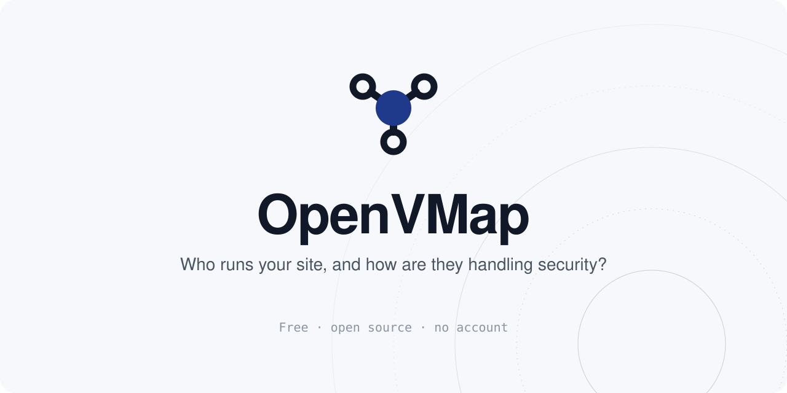

[](https://github.com/kenryu42/openvmap/actions/workflows/ci.yml)
[](https://github.com/kenryu42/openvmap/actions/workflows/vendor-sources.yml)
[](LICENSE)
[](data/LICENSE)

<div align="center">

**English** · [日本語](README.ja.md)



</div>

See who runs your website and what they have announced about security incidents, on one page, for free.

Enter a domain and OpenVMap shows:

- who hosts the site, and who runs its DNS, CDN, mail and certificate
- what each of those companies has announced about security incidents, with a link to the source
- what to do next, and a message to send your web agency or host

A flaw on the server is fixed by whoever runs the server. An outside "scan" fixes nothing.

Currently tracking: php2shell (CVE-2026-109618 / CVE-2026-109619). Read the [guide](content/guide/php2shell/en.md).

## What it does and doesn't do

A check makes only:

- public DNS and Team Cymru ASN lookups, from your browser over Cloudflare's DNS over HTTPS
- one ordinary GET of the front page, from a Cloudflare Worker
- the start of one TLS handshake, to read who issued the site's certificate

It sends no attack payloads, requests no other URL, never connects to private addresses and uses no LLM to judge a site. Checked domains are not stored. Use it on domains you manage or were asked to check.

## Limits

Whether a server is patched can't be seen from outside: hosts and Linux distributions backport fixes without changing the version number. OpenVMap tells you who to ask and what to ask. Provider status comes from each provider's announcements; check the linked source.

## Development

Needs [bun](https://bun.sh) and Node 22+. Put `SALT=<any string>` in `.dev.vars` first.

```
bun install
bun run dev     # http://localhost:3000, with the Worker
bun run check   # lint, types, tests and build
```

Deploy to Cloudflare Workers (free plan):

```
bunx wrangler secret put SALT
bun run deploy
```

## Contributing

Provider status lives in [data/providers.yaml](data/providers.yaml) and the tool list in [data/tools.yaml](data/tools.yaml); the rules are at the top of each file. Never guess an ASN, mark anything but an official announcement as `secondary`, and always link the source. The incident the site features is `incident:` at the top of `providers.yaml`, and its guide is in `content/guide/<incident>/`.

## License

Code: MIT ([LICENSE](LICENSE)). Data: CC BY 4.0 ([data/LICENSE](data/LICENSE)).
